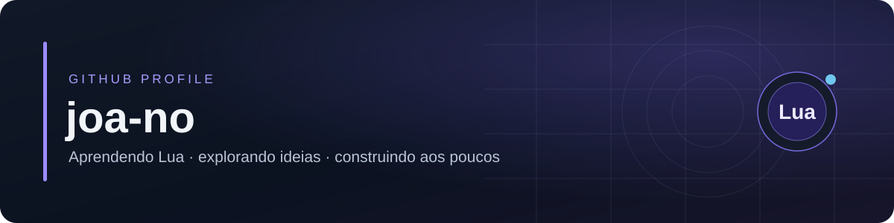

 

Um espaço pessoal para registrar aprendizados, experimentos e projetos.

  

&nbsp;

&nbsp;

 

## `01` — Sobre

<table>
<tr>
<td width="62%" valign="top">

Sou uma pessoa curiosa por tecnologia e gosto de entender como as coisas funcionam por trás da interface.

Estou começando minha jornada na programação. Meu foco atual é aprender **Lua**, fortalecer minha lógica e descobrir, na prática, como transformar ideias em projetos.

Não estou aqui para montar um currículo. Este perfil é um espaço para experimentar, aprender e guardar o que construo pelo caminho.

</td>
<td width="38%" valign="top">

### Em poucas palavras

- Aprendizado independente
- Projetos experimentais
- Interesse em desenvolvimento de jogos
- Curiosidade por sistemas e ferramentas

</td>
</tr>
</table>

---

## `02` — Projetos e experimentos

<table>
<tr>
<td width="50%" valign="top">

### 

**CodeLove**

Um repositório relacionado ao LÖVE para Android.

<a href="https://github.com/joa-no/CodeLove">Ver repositório →</a>

</td>
<td width="50%" valign="top">

### 

**Próximas experiências**

Pequenos projetos em Lua, testes com jogos 2D e ferramentas criadas durante o aprendizado.

</td>
</tr>
</table>

---

## `03` — GitHub

  

---

*“Um passo de cada vez. Sem pressa, sem atalhos.”*

Obrigado por passar por aqui.

