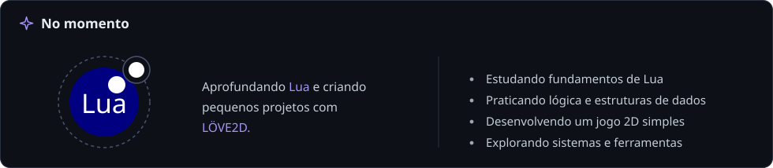
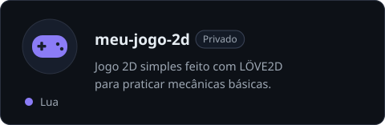
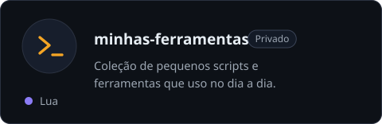
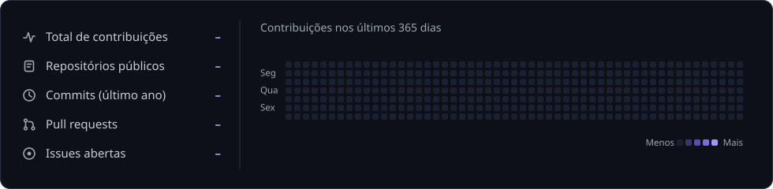

# joa-no

**Aprendendo Lua** • explorando programação e desenvolvimento de jogos

### Sobre

Curioso por natureza e movido por café e música ambiente. Gosto de entender como as coisas funcionam por baixo dos panos. Estou construindo minha base em programação e aos poucos transformando ideias simples em pequenos jogos e ferramentas úteis.

📍 Brasil &nbsp;&nbsp;·&nbsp;&nbsp; 🕒 UTC-3 &nbsp;&nbsp;·&nbsp;&nbsp; ☀️ Foco: aprender todo dia um pouco

 

## Tecnologias em estudo

## Projetos

[Ver todos os repositórios →](https://github.com/joa-no?tab=repositories)

## Atividade no GitHub

---

<i>"Um passo de cada vez, todo dia."</i> &nbsp;·&nbsp; Obrigado por visitar! 🤍

