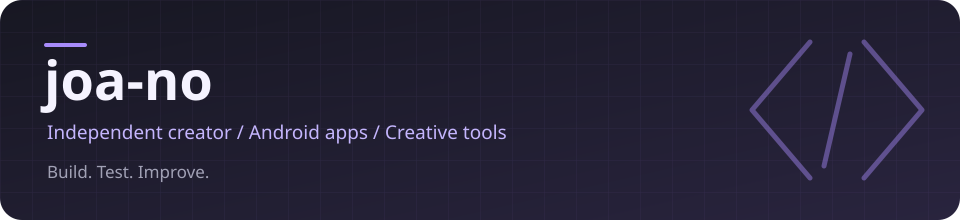

 

I build useful things, explore ideas, and learn by making them real.

[Explore my repositories](https://github.com/joa-no?tab=repositories)

## Featured projects

<table>
<tr>
<td width="100" align="center"></td>
<td><strong><a href="https://github.com/joa-no/Seoga">Seoga</a></strong> Offline-first manga and comics catalog for Android.   </td>
</tr>
<tr>
<td colspan="2" align="center">

</td>
</tr>
<tr>
<td align="center"></td>
<td><strong><a href="https://github.com/joa-no/CodeLove">CodeLove</a></strong> A native Lua and LÖVE development environment for Android.   </td>
</tr>
<tr>
<td colspan="2" align="center">

</td>
</tr>
</table>

## Tools & interests

## About

I develop Android apps and tools as independent projects, driven by curiosity and a preference for practical, straightforward software.

I care about useful features, thoughtful interfaces, and improving things through real-world testing.
