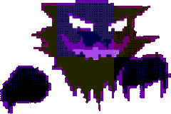

# joa-no

**Independent creator · Android apps · Creative tools**

I build useful things, explore ideas, and learn by making them real.

[**Seoga**](https://github.com/joa-no/Seoga) · [**CodeLove**](https://github.com/joa-no/CodeLove) · [**All repositories**](https://github.com/joa-no?tab=repositories)

---

### About

I develop Android apps and tools as independent projects, driven by curiosity and a preference for practical, straightforward software.

This space brings together finished apps, ongoing work, and experiments. I care about useful features, thoughtful interfaces, and improving things through real-world testing.

### Featured projects

| Project | Description | Technology |
| :-- | :-- | :-- |
| **[Seoga](https://github.com/joa-no/Seoga)** | An offline-first Android catalog for manga and comics, with reading progress, collections, and local backups. **[Get v1.0](https://github.com/joa-no/Seoga/releases/tag/v1.0)** | Kotlin · Jetpack Compose |
| **[CodeLove](https://github.com/joa-no/CodeLove)** | An Android workspace for editing Lua code and running projects with the LÖVE framework. **In development.** | Java · Lua · LÖVE |

### Tools & interests

`Android` · `Kotlin` · `Java` · `Lua` · `LÖVE` · `GitHub Actions`

---

**Build. Test. Improve.**

[Explore my projects](https://github.com/joa-no?tab=repositories)

